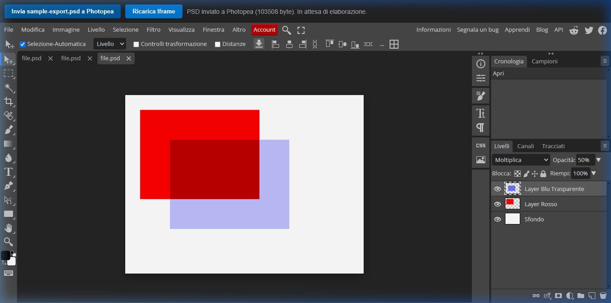
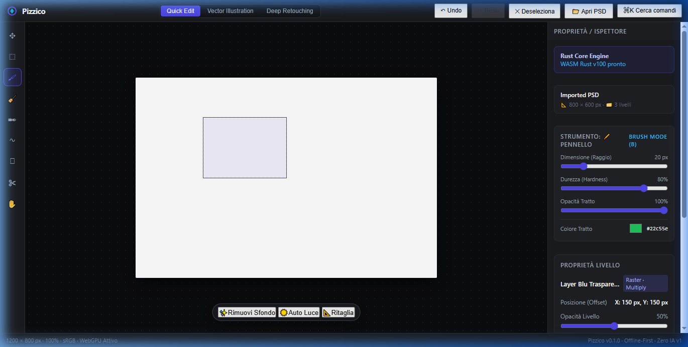
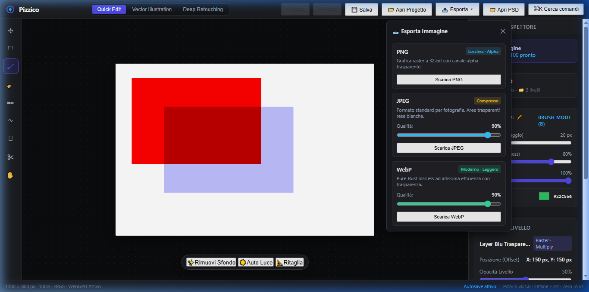
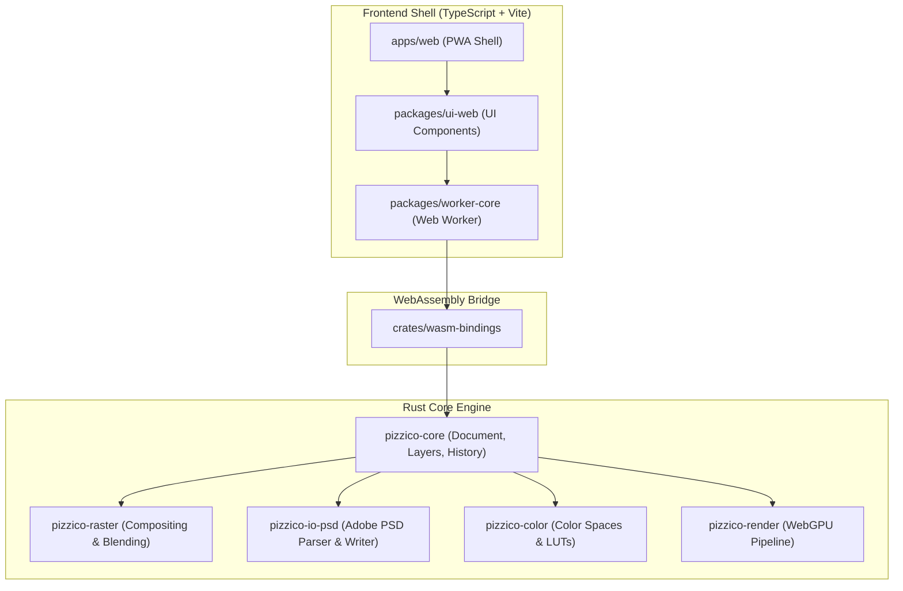

<p align="center">
  
</p>

<h1 align="center">Pizzico</h1>

<p align="center">
  <strong>A professional, offline-first graphics editor for the web and mobile, built in Rust + WebAssembly.</strong><br />
  <em>No AI, no cloud dependencies, no subscription. 100% free and open-source.</em>
</p>

<p align="center">
  <a href="https://github.com/marcorzzn/Pizzico/actions/workflows/ci.yml"></a>
  <a href="https://pizzico.pages.dev"></a>
  <a href="./LICENSE-MIT"></a>
  <a href="./NOTICE.md"></a>
  <a href="./docs/clean-room/methodology.md"></a>
</p>

---

## Overview

**Pizzico** is a high-performance raster and vector graphics editor designed from the ground up to run locally in your browser and on mobile devices. Powered by a pure-Rust core compiled to WebAssembly with WebGPU hardware acceleration, Pizzico delivers desktop-grade editing with zero cloud lock-in.

- **Offline-First & Local Storage**: Loads instantly from cache and saves your work locally via the Origin Private File System (OPFS) and IndexedDB.
- **Full Photoshop PSD Compatibility**: Full import and export of Adobe Photoshop PSD files with layers, blend modes, and opacity, independently verified with Adobe Photoshop and Photopea.
- **Deterministic & Scientific**: No opaque AI API calls or paid cloud inference. Advanced features use verified, peer-reviewed computer science literature.
- **Zero Cost & Free**: Dual-licensed under MIT and Apache-2.0.

---

## Showcase

<p align="center">
  
  <br />
  <em>Adobe Photoshop PSD Export: Verified in Photopea with preserved layer hierarchy, blend modes, and opacity.</em>
</p>

<p align="center">
  
  
</p>

---

## Features

- **PSD Codec**: Import and export layered `.psd` files (PackBits RLE compression, tagged blocks `luni`, `lyid`, `lsct`).
- **Layer Engine**: Full raster and vector layer stack with 24 blend modes, opacity, visibility toggles, and reordering.
- **High-Performance Brush**: Pressure-sensitive, anti-aliased continuous strokes running at 60 FPS.
- **Undo / Redo History**: Bounding-box-optimized atomic undo/redo with instant memory rollback.
- **Precision Selection**: Rectangular selection marquee with clipping mask constraints.
- **Multi-Format Export**: Export to PNG, JPEG, WebP, and layered PSD.
- **Persistence**: Automatic background saving using the Origin Private File System (OPFS) and IndexedDB fallback.
- **WebGPU Rendering**: Compute-shader compositing with graceful WebGL2 and Canvas fallback.
- **PWA & Mobile Ready**: Progressive Web App installable on any modern desktop or smartphone.

---

## Quick Start

### Online Demo
Try Pizzico directly in your browser without installation:
👉 **[https://pizzico.pages.dev](https://pizzico.pages.dev)**

### Local Development

#### Prerequisites
- **Node.js** >= 20.x
- **pnpm** >= 9.x
- **Rust** >= 1.78 with the `wasm32-unknown-unknown` target
- **wasm-pack**: `cargo install wasm-pack`

#### Clone and Run
```bash
# Clone the repository
git clone https://github.com/marcorzzn/Pizzico.git
cd Pizzico

# Install workspace dependencies
pnpm install

# Build the Rust core to WebAssembly
pnpm build:wasm

# Start the local development server
pnpm dev
```

Open `http://localhost:5173` in your browser.

---

## Architecture

Pizzico employs a modular clean-room architecture separating the memory-safe computational core from the web shell:



---

## Documentation

- **[Architectural Decision Records (ADR)](docs/ADR/)**: Design choices, tradeoffs, and system evolution.
- **[Algorithm References](docs/algorithms/)**: Mathematical specifications and paper citations for every algorithm.
- **[Milestone Progress](docs/milestones/)**: Phase milestones, verification criteria, and test logs.
- **[Clean-Room Methodology](docs/clean-room/methodology.md)**: Intellectual property isolation and provenance tracking.

---

## Contributing

We welcome contributions! Please review [CONTRIBUTING.md](CONTRIBUTING.md) for details on code style, commit conventions, testing requirements, and submission processes.

---

## License

Pizzico is dual-licensed under:
- **MIT License** ([LICENSE-MIT](LICENSE-MIT) or [http://opensource.org/licenses/MIT](http://opensource.org/licenses/MIT))
- **Apache License, Version 2.0** ([LICENSE-APACHE](LICENSE-APACHE) or [http://www.apache.org/licenses/LICENSE-2.0](http://www.apache.org/licenses/LICENSE-2.0))

All documentation is licensed under **Creative Commons Attribution 4.0 International (CC-BY-4.0)**.

---

## Live Demo

Try Pizzico now: [https://pizzico.pages.dev/](https://pizzico.pages.dev/)  
Works offline after first load. Import a PSD to get started.
