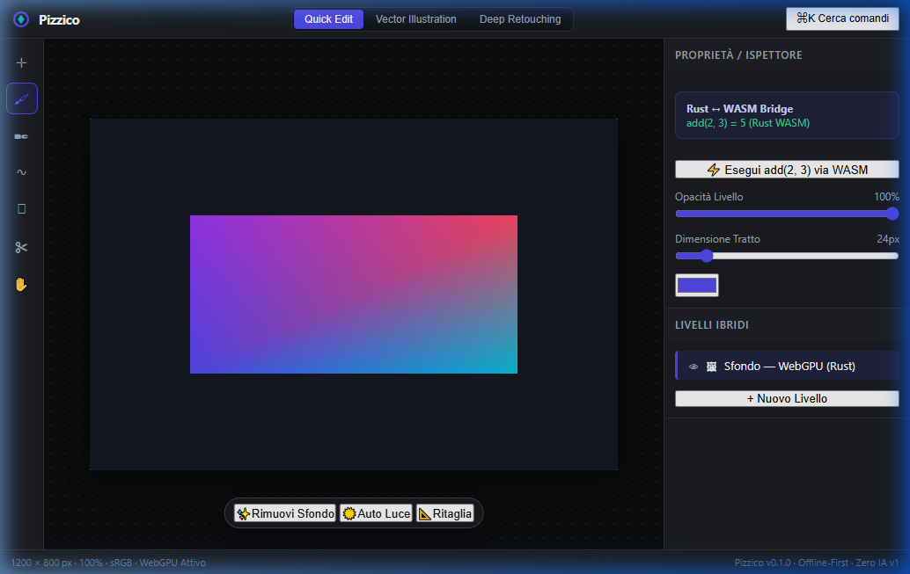

<!--
Pizzico — docs/milestones/fase-0.md
Riferimento manifesto: §3.1, §4, §6.2, §11 Step 8, §12
Licenza: MIT OR Apache-2.0
-->

# 🍕 Milestone: Fase 0 Completata con Successo

**Data di Chiusura:** 22 Ottobre 2026  
**Stato:** Ufficialmente Completata e Verificata End-to-End  
**Responsabile:** Team Pizzico / Clean Room Laboratory  

---

## 1. Obiettivi del Manifesto per la Fase 0

La **Fase 0** (Manifesto Programmatico §11 Step 8) costituisce la verifica della fattibilità fondamentale dell'architettura Pizzico:
dimostrare che il core engine scritto in Rust compila per WebAssembly (`wasm32-unknown-unknown`), si interfaccia bidirezionalmente con una shell TypeScript e orchestra direttamente la pipeline grafica WebGPU a 60 FPS senza logica di rendering duplicata in JavaScript.

Tutti gli obiettivi della Fase 0 sono stati raggiunti:

| Requisito Manifesto | Componente Ingegneristico | Esito |
|---|---|:---:|
| **§3.1 — Core Rust in WASM** | Modulo `pizzico-wasm-bindings` compilato con `wasm-pack` (`target = web`) | ✅ Superato |
| **§4 — Monorepo & Workspace** | Workspace Cargo (13 crate) + Workspace pnpm sincronizzati | ✅ Superato |
| **§6.2 — WebGPU Native Surface** | Inizializzazione Adapter/Device e pipeline WGSL da Rust via `web-sys` | ✅ Superato |
| **§11 Step 8 — Bridge JS ↔ Rust** | Test `add(2, 3) = 5` e `pizzico_version() = 100` tramite `#[wasm_bindgen]` | ✅ Superato |
| **§12 — Shell UI Disaccoppiata** | `apps/web/src/main.ts` privo di codice WebGPU; delega completa a Rust | ✅ Superato |

---

## 2. Metriche e Artefatti Generati

1. **Binario WebAssembly Ottimizzato**:
   - Percorso: `packages/worker-core/pkg/pizzico_wasm_bindings_bg.wasm`
   - Dimensione: **83.4 kB** (compilato in `--release` e ottimizzato con `wasm-opt -Oz --enable-mutable-globals`).
2. **Definizioni TypeScript & Glue Code**:
   - Percorsi: `pizzico_wasm_bindings.d.ts` e `pizzico_wasm_bindings.js`.
   - Re-export trasparente dal modulo workspace `@pizzico/worker-core`.
3. **Bundle Web di Produzione (Vite 5)**:
   - Output `dist/` validato con bundle JS (22.6 kB), CSS (6.6 kB) e file `.wasm` hash-versionato.
   - Header di sicurezza COOP (`same-origin`) e COEP (`require-corp`) attivi tramite `_headers`.

---

## 3. Evidenza Visiva nel Browser

La verifica è stata condotta in una sessione di navigazione reale sul server locale `http://localhost:5173/`:



### Comportamento Riscontrato:
- **Canvas centrale**: Il render loop WebGPU a 60 FPS renderizza il rettangolo sfumato con la palette ufficiale Pizzico (Indigo `#4f46e5`, Cyan `#06b6d4`, Rose `#f43f5e`, Purple `#9333ea`) tramite shader WGSL a 6 vertici compilato interamente nel core Rust.
- **Inspector (Pannello destro)**: Il click sul pulsante *⚡ Esegui add(2, 3) via WASM* ha aggiornato il badge DOM visualizzando istantaneamente `add(2, 3) = 5 (Rust WASM)`.

---

## 4. Log della Console DevTools (F12)

```text
🍕 Pizzico Engine initializing…
[WASM Bridge] ✅ Modulo Rust inizializzato — version: 100, add(2,3) = 5
[WebGPU] ✅ Render loop Rust attivo — 60 FPS via RAF
[Workspace] Modalità attiva: Design
[WASM Bridge Click] add(2, 3) = 5
```

---

## 5. Dettagli Architetturali Chiave

### 5.1 Isolamento Rigoroso del Rendering (§12)
Nessuna API WebGPU (`requestAdapter`, `requestDevice`, `createShaderModule`, `createRenderPipeline`, ecc.) viene invocata da TypeScript. La shell web in `apps/web/src/main.ts` si limita a preparare l'elemento `<canvas id="pizzico-canvas">` e chiamare:

```typescript
await initWasm();
await init_webgpu('pizzico-canvas');
```

Tutta la gestione dei buffer, della command queue, del render pass e del loop ricorsivo `requestAnimationFrame` risiede in `crates/wasm-bindings/src/gpu/render.rs`.

### 5.2 Patch Locale per Desktop Heap Windows (ADR 0003)
Per aggirare un limite architetturale dei runner di sistema non-interattivi su Windows (errore Desktop Heap `0xC0000142` in `rustversion`), è stata isolata e documentata una patch locale in `tools/patches/rustversion`, tracciata formalmente nell'ADR 0003 e nel file `NOTICE.md`.

---

## 6. Conclusione e Passaggio alla Fase 1

Con la Fase 0 chiusa e validata:
- La pipeline Rust → WASM → WebGPU è solida, riproducibile e performante.
- Il progetto entra nella **Fase 1 (Editor raster MVP)**, focalizzandosi sul **Core Document** (`crates/core`) e successivamente sul parser del formato PSD (`crates/io-psd`).
