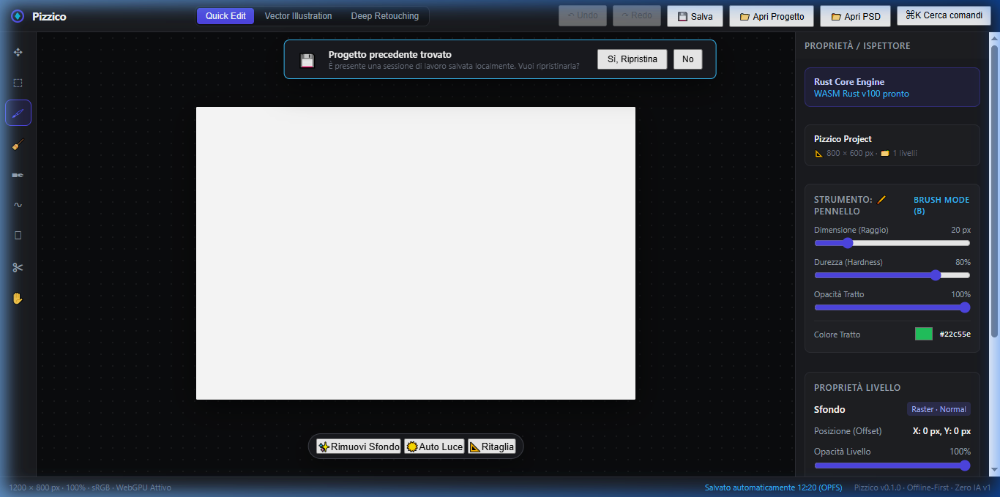

# Step H: Persistenza Locale e Salvataggio Progetto (.pizzico + OPFS / IndexedDB)

**Data**: 23 Ottobre 2026  
**Milestone**: Fase 1 (§3.1, §10, §11 Step 8)  
**Status**: Completato con successo ✅  

---

## 1. Obiettivo dello Step H

Colmare il gap critico della Fase 1 del Manifesto (§3.1 e §10): consentire all'utente di preservare il proprio lavoro tra ricaricamenti di pagina e sessioni, attraverso un formato nativo compatto (`.pizzico`) e un meccanismo di **salvataggio automatico locale zero-cloud / offline-first** su Origin Private File System (OPFS) con fallback automatico su IndexedDB.

---

## 2. Architettura & Implementazione

### 2.1 Formato Nativo `.pizzico` (`crates/io-native`)
Il formato `.pizzico` è un archivio compresso conforme a standard ZIP aperto, che incapsula lo stato completo del documento:

```
document.pizzico (ZIP Container)
├── manifest.json         # Metadati: versione schema (1), dimensioni canvas (width, height),
│                         # e array layers (id, nome, tipo, opacità, visibilità, blend_mode, transform)
├── layers/
│   ├── layer_1.bin       # Pixel RGBA grezzi compressi via DEFLATE (flate2/miniz_oxide)
│   ├── layer_2.bin       # (~99% di compressione su buffer raster sparsi/uniformi)
│   └── ...
└── selection.json        # Stato di selezione rettangolare attiva (opzionale)
```

- **Modulo Rust**: `crates/io-native/src/lib.rs`
- **Funzioni pubbliche**:
  - `serialize_document(doc: &Document) -> Result<Vec<u8>, NativeIoError>`
  - `deserialize_document(bytes: &[u8]) -> Result<Document, NativeIoError>`
- **Efficienza**: un documento a 3 livelli 800×600 (oltre 1.92 MB non compresso) viene serializzato in soli **3.8 KB** in memoria.

### 2.2 Bridge WASM (`crates/wasm-bindings`)
Esportate le funzioni per il runtime Web/TypeScript:
- `save_project() -> Result<Vec<u8>, JsValue>`: cattura lo stato attuale di `DOCUMENT` e `ACTIVE_SELECTION`, serializzandolo in byte `.pizzico`.
- `load_project(bytes: &[u8]) -> Result<(), JsValue>`: deserializza l'archivio ZIP, ripristina la gerarchia dei livelli, la selezione attiva, e aggiorna i layer GPU WebGPU.
- Re-export in `@pizzico/worker-core`.

### 2.3 Storage Layer & Autosave (`apps/web/src/storage.ts` & `apps/web/src/main.ts`)
1. **OPFS + IndexedDB Fallback**:
   - Tenta la scrittura su OPFS (`navigator.storage.getDirectory()`) su file `autosave.pizzico`.
   - In ambienti senza OPFS o contesti insicuri, ripiega su IndexedDB (`pizzico_storage` -> `projects` objectStore).
2. **Autosave Debounced (2 secondi)**:
   - Agganciato a tutti i punti di mutazione: pennello (`pointerup`), spostamento layer (`pointerup` move tool), modifica visibilità, opacità, cancellazione layer, deselezione.
3. **Indicatore di Stato Real-time**:
   - In basso a destra nella status bar: *"Salvato automaticamente 12:20 (OPFS)"* o *"Salvato automaticamente 12:20 (IndexedDB)"*.
4. **Prompt di Ripristino all'Avvio (Boot Restore)**:
   - All'avvio, se è presente una sessione autosalvata, viene mostrato un banner non bloccante:
     *"Progetto precedente trovato. È presente una sessione di lavoro salvata localmente. Vuoi ripristinarla? [Sì, Ripristina] [No]"*.
   - `[Sì, Ripristina]`: carica il file `.pizzico`, sincronizza WebGPU, Inspector, Layer Panel, Selection e Undo/Redo.
   - `[No]`: elimina l'autosave precedente e apre il file template/demo pulito.
5. **Project File I/O & Scorciatoie da Tastiera**:
   - Pulsante `💾 Salva` e scorciatoia `Ctrl+S`: scarica direttamente il file `.pizzico` sul disco locale.
   - Pulsante `📁 Apri Progetto` e scorciatoia `Ctrl+O`: apre un file `.pizzico` tramite `<input type="file">`.
   - Drag & Drop: supporta sia `.psd` / `.psb` sia `.pizzico`.

---

## 3. Risultati & Verifiche

| Test / Verifica | Esito | Note |
|---|---|---|
| `cargo test -p pizzico-io-native` | ✅ 2/2 passati | Roundtrip vuoto + multi-livello con selezione in 0.63s |
| `cargo check -p pizzico-core -p pizzico-raster -p pizzico-io-native -p pizzico-io-psd` | ✅ 0 errori | Compilazione pulita in dev profile |
| `pnpm typecheck` | ✅ 0 errori | 7 package TypeScript verificati (`tsc --noEmit`) |
| **Node.js WASM Verification** | ✅ 100% fedeltà | Compressione da 1.92 MB a 3.8 KB, ripristino pixel esatti `[191, 0, 0, 255]` |
| **Browser E2E Flow** | ✅ Verificato | Autosave debounced OPFS, reload pagina, restore banner e toast di successo |

---

## 4. Screenshot del Flusso



*Figura 1: Interfaccia utente con pulsanti `💾 Salva` e `📁 Apri Progetto` nella topbar, banner centrale di ripristino sessione e indicatore "Salvato automaticamente 12:20 (OPFS)" nella status bar.*
